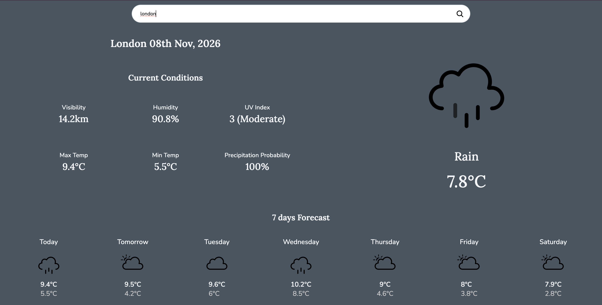
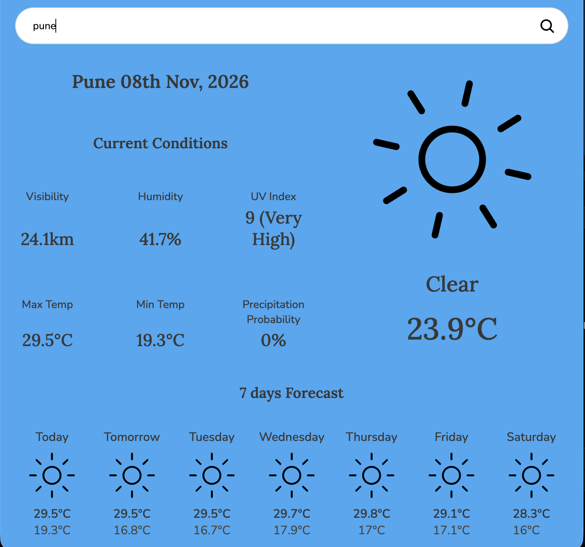
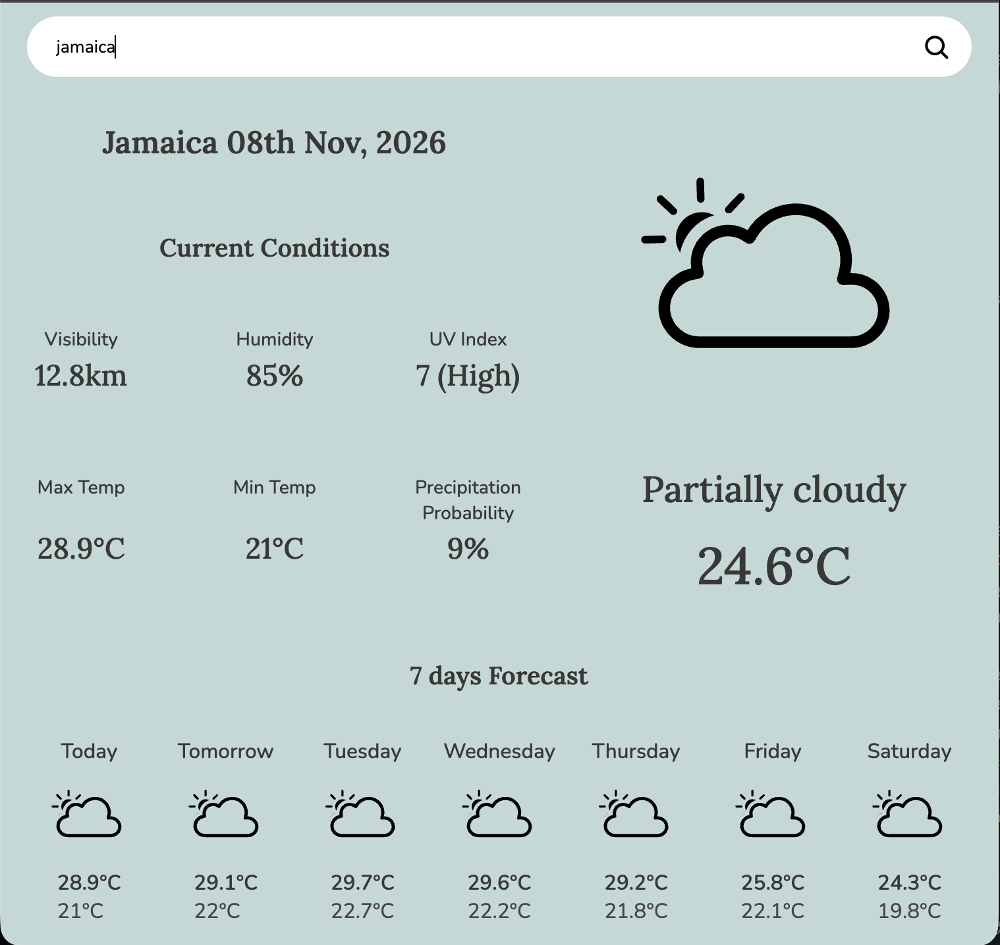
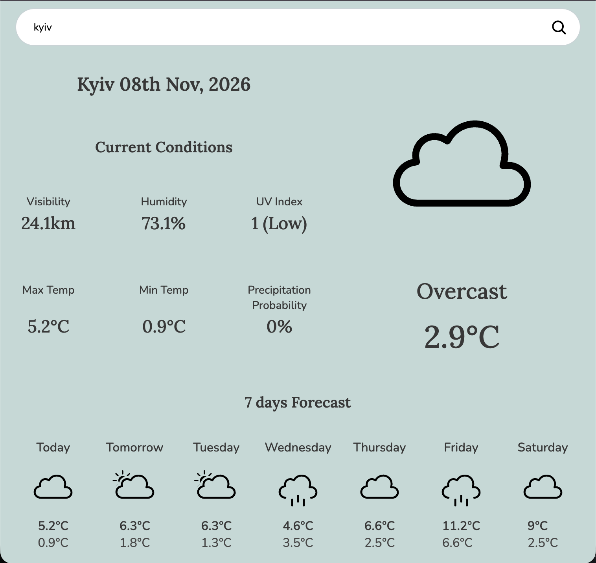
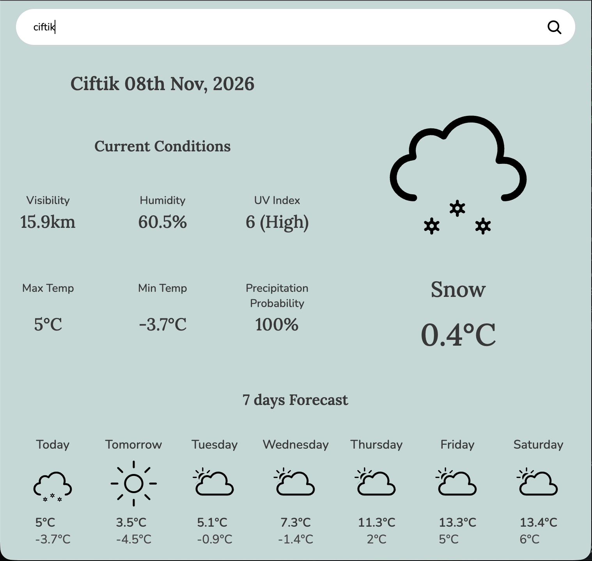
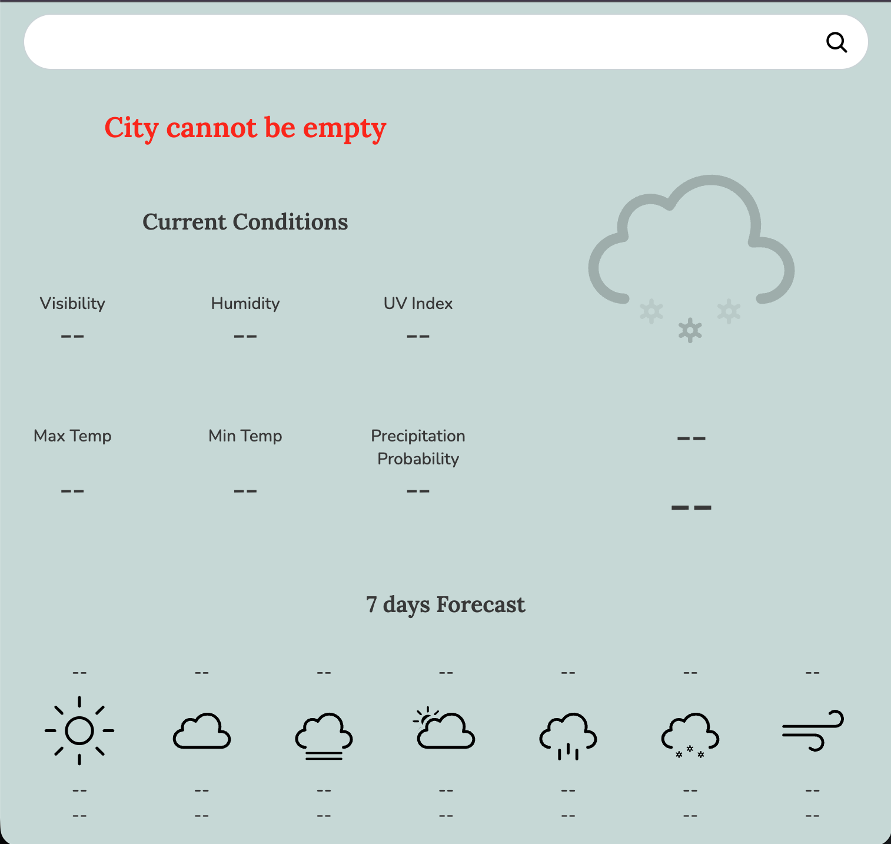
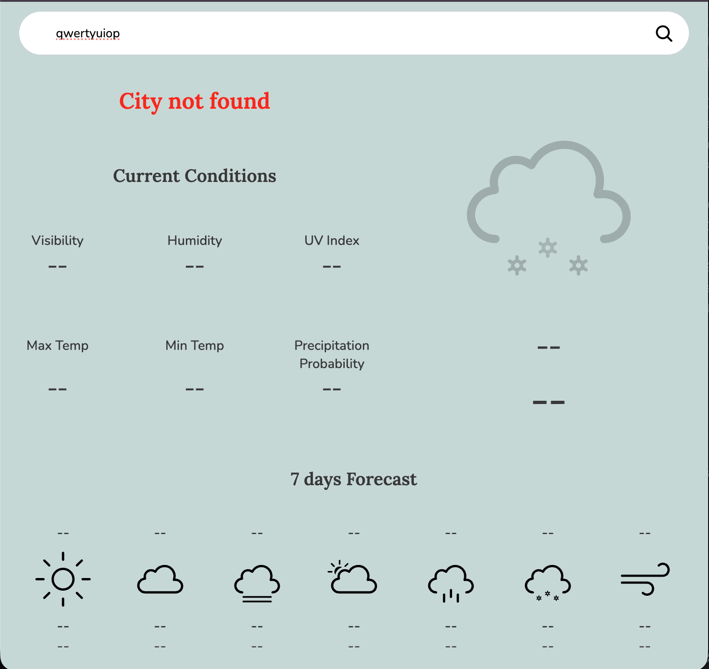

# Weather App

A weather app that shows current conditions and a 7-day forecast for any city, built to practice async JavaScript and working with a real API.

**Live demo:** https://rugved1218.github.io/Weather/

## Features

- **The whole day in one search.** Type a city and get the temperature, visibility, humidity, UV index with a plain-language health label, today's high and low, and the chance of rain.
- **A week at a glance.** Seven forecast cards show the day, an icon and the high and low for each, with "Today" and "Tomorrow" instead of dates where it makes sense.
- **A page that follows the weather.** The background changes with the conditions, and the main icon is animated.
- **An empty state that doesn't pretend.** Before you search, every value shows `--`, the big icon is dimmed, and the headline invites you to enter a city. Nothing on screen looks like a real reading until there is one. A failed search returns to this same state.
- **Fast.** One API request per search. An earlier version made eight, one for today and one for each forecast day, and the lag was noticeable.
- **Errors that don't break the page.** Bad input, unknown cities and lost connections each show a clear message instead of leaving half-updated data on screen.
- **Keyboard friendly.** Press Enter to search, no need to click.

## Preview

### Weather-based backgrounds

The whole page changes with the conditions.

|                  Sunny                  |                    Partially cloudy                     |           Cloudy/Overcast           |
| :-------------------------------------: | :-----------------------------------------------------: | :---------------------------------: |
|  |  |  |

|                 Rainy                  |               Snowy               |
| :------------------------------------: | :-------------------------------: |
|  |  |

### Empty state

### Error handling

## How it works

Each file has one job.

| File           | Job                                                                                                                                         |
| -------------- | ------------------------------------------------------------------------------------------------------------------------------------------- |
| `ApiCall.js`   | The only code that talks to the network. Makes one request per search, checks the response, and throws a clear error if something is wrong. |
| `Search.js`    | Takes the raw API data and turns it into what the UI needs: formatted dates, temperatures, icon names.                                      |
| `strings.js`   | Small formatting helpers (temperatures, percentages, dates, UV labels).                                                                     |
| `index.js`     | Handles clicks, calls the other layers, and is the only place that updates the page.                                                        |
| reset function | Puts every element back to the empty state. Used on startup and after any failed search.                                                    |

A search works like this: `index.js` calls `load()` once, which makes the single API request. Today's data and each forecast day are then read from that one result, and the page is updated only after all of it has arrived.

## Error handling

Errors are thrown in the lower layers and caught in one place, `index.js`. That layer is the only one that knows about the screen, so it decides what the user sees. On any failure the page resets to the empty state and the headline shows the message.

| What went wrong                | What the user sees                             |
| ------------------------------ | ---------------------------------------------- |
| Empty or whitespace-only input | City cannot be empty                           |
| City not found (HTTP 400)      | City not found                                 |
| Rate limit hit (HTTP 429)      | Weather Data not available rn, pls check later |
| No network                     | Failed to fetch Data                           |
| Any other error status         | Something went wrong, please try again         |

## Tech stack

- **JavaScript:** ES modules, classes, async/await
- **HTML5 and CSS3:** hand-written layout and styling, with Google Fonts (Lora, Nunito)
- **webpack:** bundles the JavaScript, CSS and SVG icons
- **Visual Crossing Timeline API:** weather data
- **ESLint and Prettier:** linting and consistent formatting
- **Git and GitHub Pages:** version control and hosting

## Credits

Weather data from the [Visual Crossing Timeline API](https://www.visualcrossing.com/weather-api). Built as part of The Odin Project.
